# ShopNest

A full-stack online store built with the **MEAN stack** (MongoDB, Express, Angular, Node.js).
Shoppers can browse 62 products, search and filter, add to a bag, apply coupons and pay with **Razorpay (test mode)** or **Cash on Delivery**. An admin dashboard manages products, orders and coupons.

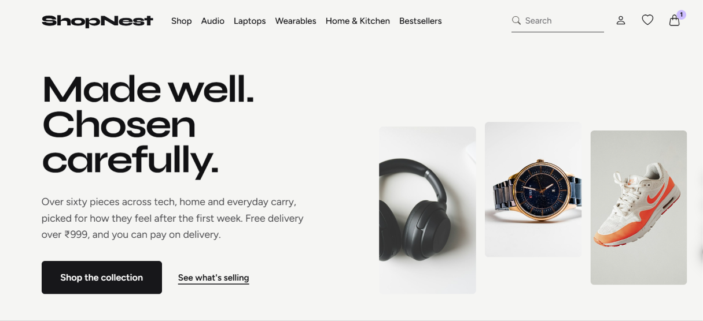

## Screenshots

| | |
|---|---|
| **Categories**<br>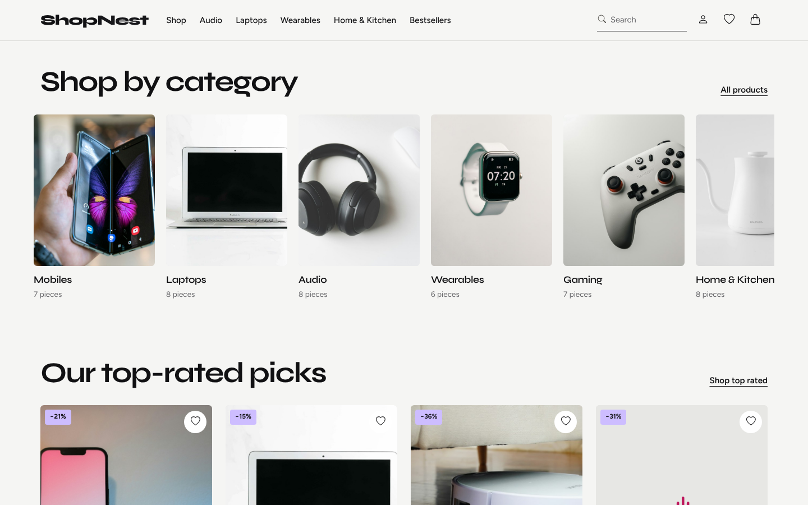 | **Shop**: search, filters, sorting<br>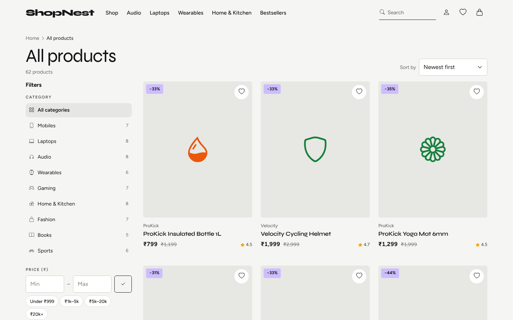 |
| **Product page**<br>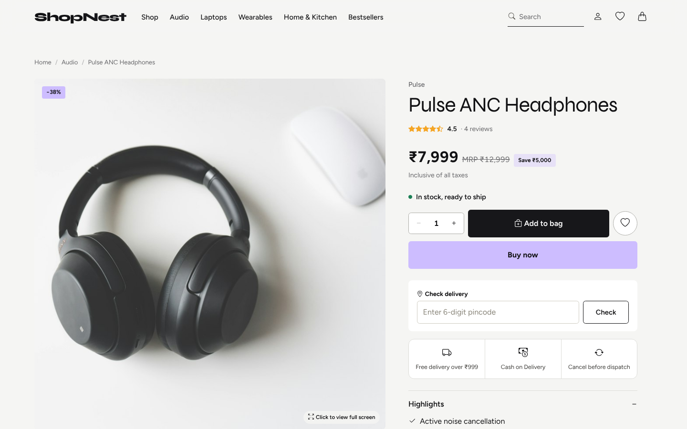 | **Bag**<br>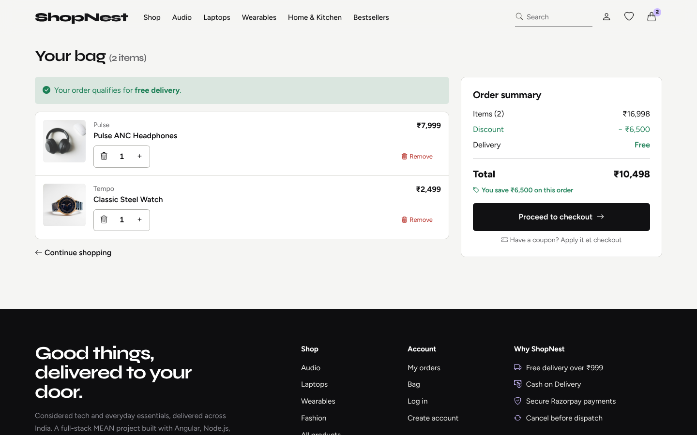 |
| **Log in** (email or Google)<br>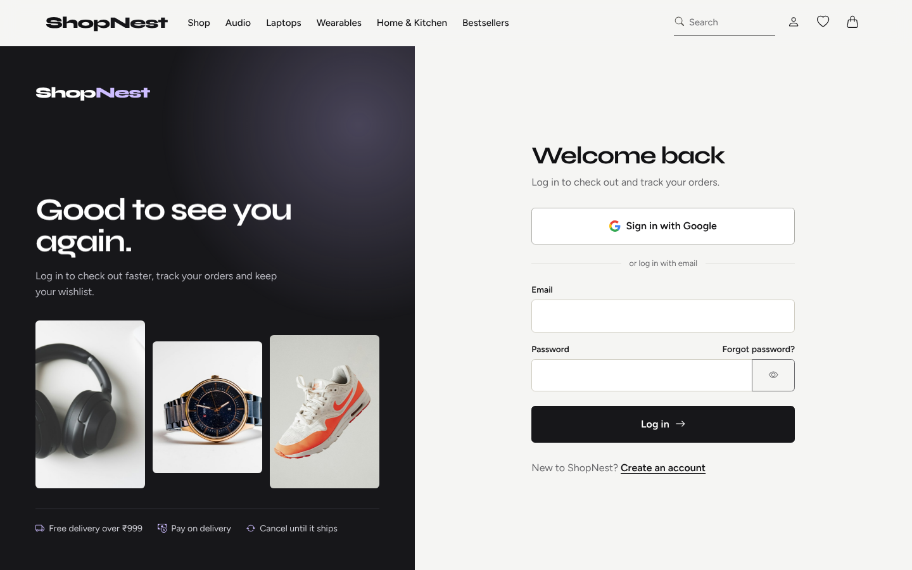 | **Create account**<br>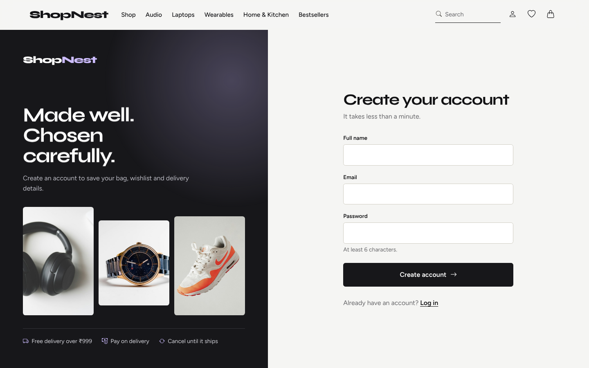 |
| **Admin dashboard**<br>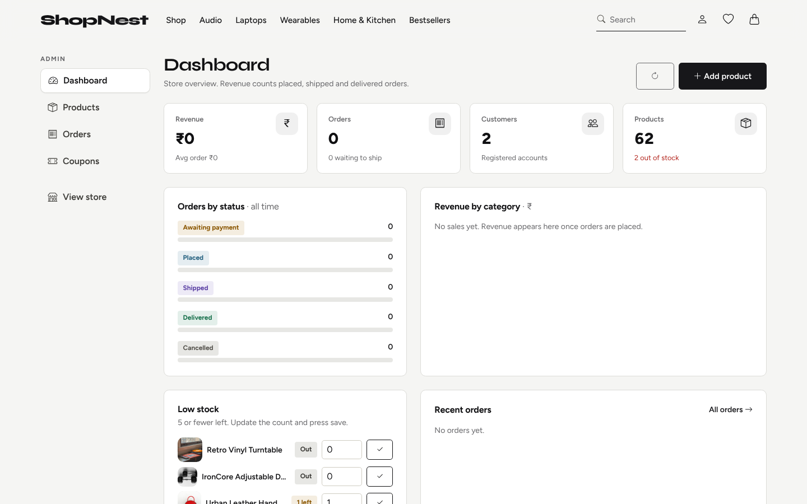 | **Admin: products**<br>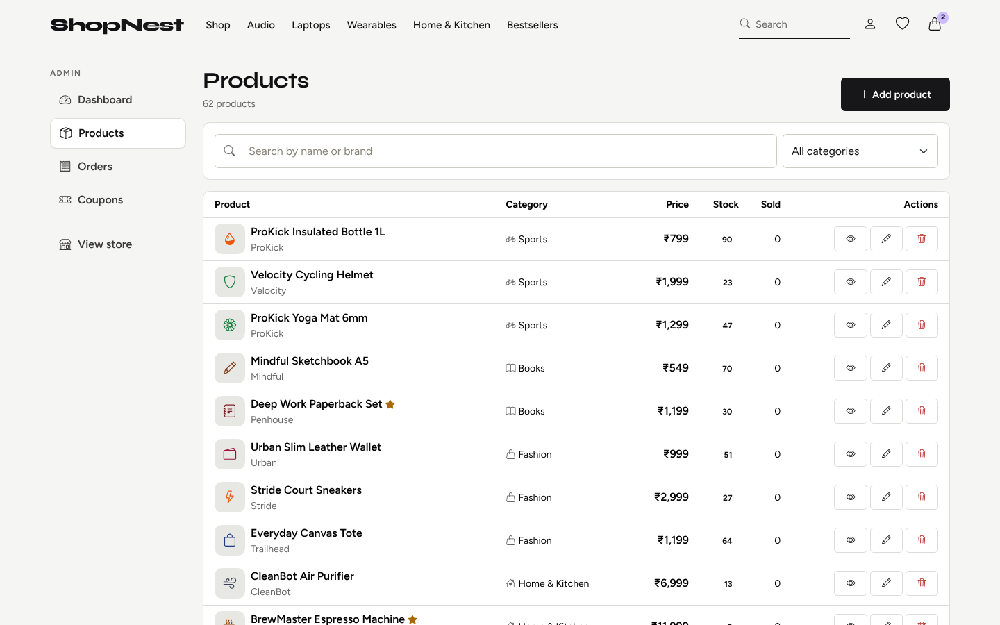 |
| **Admin: coupons**<br>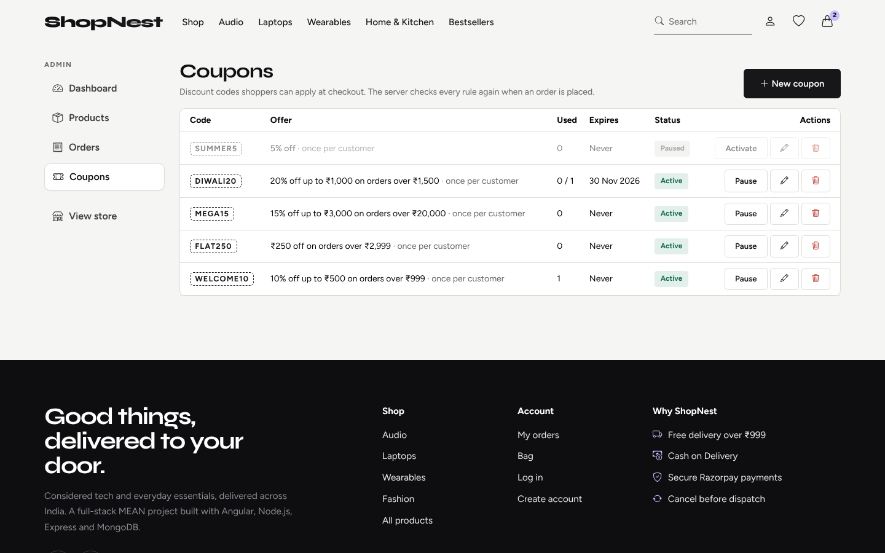 | **Mobile**<br>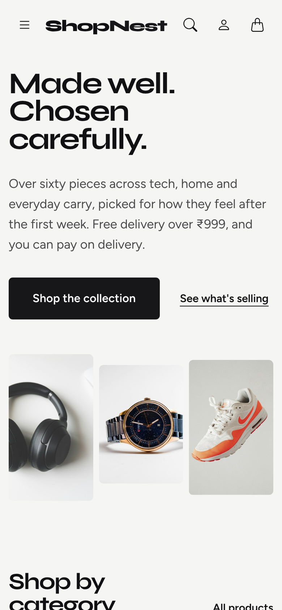 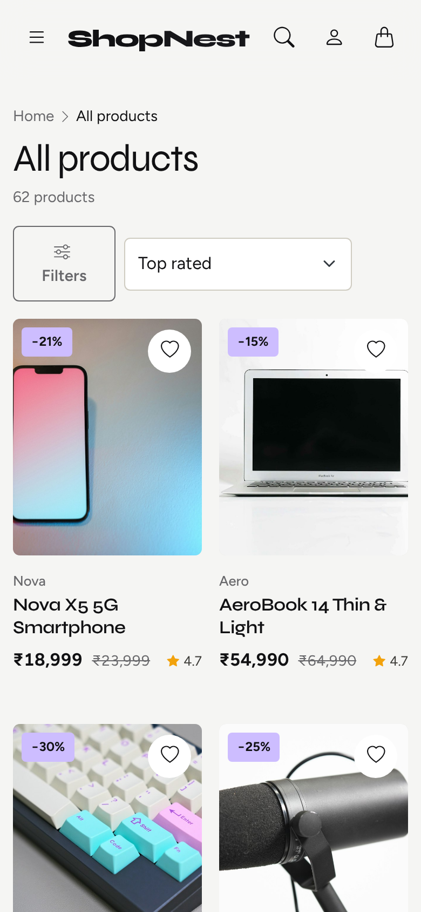 |

## Features

**Shoppers**
- Search with live suggestions, category / price / stock filters, sorting and pagination
- Product page with photo gallery, reviews and ratings, and a pincode delivery check
- Wishlist, recently viewed products, bag saved in the browser
- Coupon codes, checkout with address validation, Razorpay or Cash on Delivery
- My Orders with tracking and cancel-before-shipping
- Sign in with email or Google, forgot / reset password

**Admin**
- Dashboard with revenue, orders, customers and low-stock list
- Add, edit and delete products; move orders through placed, shipped and delivered
- Create and pause coupons

**Built with**
Angular 22 (standalone components, signals), Bootstrap 5, Motion animations, Node.js, Express 5, MongoDB with Mongoose, JWT authentication, Razorpay, Google sign-in.

## How to run

You need **Node.js 22.22.3 or newer** (check with `node -v`). MongoDB is optional.

```bash
# 1. Install everything
npm run install-all

# 2. Create the settings file
#    Windows:      copy server\.env.example server\.env
#    macOS/Linux:  cp server/.env.example server/.env

# 3. Start the API and the website together
npm run dev
```

Then open `localhost:4200` in your browser.

If `MONGO_URI` in `server/.env` is empty, a temporary in-memory database is used and it resets on every restart.
To keep your data, install MongoDB and set `MONGO_URI=mongodb://127.0.0.1:27017/shopnest`, then run `npm run seed` once to load the demo products.

**Demo logins**

| Role | Email | Password |
|---|---|---|
| Admin | admin@shopnest.dev | Admin@123 |
| Customer | demo@shopnest.dev | Demo@123 |

## Optional setup

All of these go in `server/.env`. Restart `npm run dev` after changing it.

**Google sign-in**
1. In [Google Cloud Console](https://console.cloud.google.com), open **Google Auth Platform**, set up the consent screen (External) and add your Gmail under **Audience → Test users**.
2. Under **Clients → Create client** choose **Web application** and add `http://localhost:4200` under **Authorized JavaScript origins**.
3. Set `GOOGLE_CLIENT_ID=` to the Client ID. No client secret is needed.

**Razorpay (test mode)**
1. Turn on Test Mode in the Razorpay dashboard and create API keys.
2. Set `RAZORPAY_KEY_ID` and `RAZORPAY_KEY_SECRET`. Without them, only Cash on Delivery is offered.

**Product photos**
1. Create a free token at [huggingface.co/settings/tokens](https://huggingface.co/settings/tokens) (Fine-grained, with "Make calls to Inference Providers").
2. Set `HF_TOKEN=` in `.env`, then run `npm run images`. Photos are saved to `client/public/images/products/`, and products without a photo show an icon.
3. Restart the server so the photos are linked.

**Forgot password**
There is no email service yet. In development the reset link is printed in the server console and shown on the page.

## Production build

```bash
npm run build   # builds the Angular app
npm start       # serves the API and the app on http://localhost:5000
```

## Project structure

```
ShopNest/
├── client/    Angular app (pages, admin, services, shared components)
├── server/    Express API (routes, models, middleware, seed data)
└── docs/      screenshots
```

## Author

**Aditya Kale** · [GitHub](https://github.com/Adityak0012) · [LinkedIn](https://www.linkedin.com/in/AdityaK0012)
