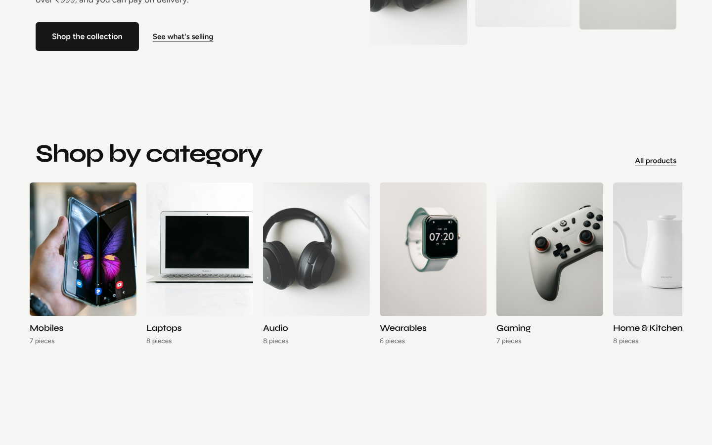

# ShopNest – Full-Stack MEAN E-Commerce Platform

ShopNest is an online store built with the **MEAN stack**: **MongoDB, Express.js, Angular and Node.js**.
Customers can search and filter products, add them to a cart and check out with **Razorpay (test mode)** or **Cash on Delivery**.
Admins get a dashboard to manage products, stock, orders and coupons.

Product photos are **AI-generated with Hugging Face** (FLUX.1-schnell) and stored in `client/public/images/products/`. Any product without a photo falls back to a **Bootstrap Icon** on a coloured tile.

## Screenshots

| Home | Shop |
|---|---|
|  |  |
| **Product** | **Admin dashboard** |
|  |  |

<p align="center"></p>

## Features

**Customers**
- Catalogue of **62 products across 9 categories**, with **live search suggestions**, **category filter**, **price range**, **in-stock filter**, **sorting** and **server-side pagination**. Filters live in the URL, so a filtered page can be shared.
- Product page with a **photo gallery and full-screen viewer**, discount, stock status, highlights, **customer reviews and ratings**, related products and a **pincode delivery estimate**.
- **Wishlist**, plus **recently viewed** and **just added** sections on the home page.
- Cart saved in the browser, with stock-based quantity limits and a free-delivery progress message.
- **Coupon codes** (percent or flat, minimum order, usage limits, one per customer) re-checked on the server at checkout.
- Checkout with address validation (10-digit mobile, 6-digit PIN, Indian states) and **Razorpay (test mode)** or **Cash on Delivery**.
- My Orders with a delivery tracker and cancel-before-shipping (stock and coupon are released).
- **Sign in with Google**, email and password login, and **forgot / reset password**.
- Info pages: About, Contact, Shipping & returns, Privacy, Terms, and a custom 404.

**Admin**
- Dashboard: revenue, orders, customers, low-stock list with quick stock update, orders by status, revenue by category.
- Products: search, add, edit, delete. Orders: move through `placed → shipped → delivered` or cancel.
- **Coupons**: create, edit, pause and delete discount codes.

**Design and motion**
- "Atelier Mono" design system: warm off-white canvas, charcoal ink, a single lilac highlight, Syne for headings and Figtree for text. Sticky header, photo-led product cards and a clean row of category tiles. Fully responsive.
- Animations built with the [`motion`](https://motion.dev) library (scroll reveals, staggered grids, hero intro, parallax photos) plus View Transitions between pages. All of it respects `prefers-reduced-motion`.

**Security and reliability**
- **JWT authentication**, bcrypt password hashes, HTTP interceptor, auto logout on expiry. Google ID tokens are verified on the server.
- **Role-based access** with Angular route guards and a second check on every admin API route.
- Prices are always read from the database, never trusted from the browser.
- Stock is reserved with an atomic MongoDB update so two buyers cannot buy the last unit; it rolls back on failure.
- Razorpay payments verified with an HMAC-SHA256 signature check.
- Password reset tokens are random, stored hashed, single-use and expire in 30 minutes.
- Input validation (express-validator), security headers (Helmet), central error handling.

## Tech stack

| Layer | Tools |
|---|---|
| Frontend | Angular 22 (standalone components, signals, reactive forms, lazy-loaded routes), TypeScript, RxJS, Bootstrap 5, Bootstrap Icons, Motion |
| Backend | Node.js, Express 5, Mongoose, JWT, bcryptjs, express-validator, Helmet, Razorpay SDK, google-auth-library |
| Database | MongoDB (local, Atlas, or an automatic in-memory database for quick demos) |

## Project structure

```
ShopNest/
├── client/                 Angular app
│   ├── public/images/products/   product photos (generated by npm run images)
│   └── src/app/
│       ├── core/           models, services (auth, cart, shop, razorpay, toast), guards, interceptor
│       ├── shared/         product card, pagination, toasts, ₹ currency pipe
│       ├── layout/         navbar, footer
│       ├── pages/          home, shop, product, cart, checkout, orders, auth, info pages, 404
│       └── admin/          dashboard, products, product form, orders, coupons
├── server/                 Express API
│   └── src/
│       ├── config/         environment and MongoDB connection
│       ├── models/         User, Product, Order, Review, Coupon
│       ├── middleware/     JWT auth, admin check, validation, errors
│       ├── routes/         auth, products, orders, reviews, wishlist, coupons, admin
│       └── seed/           62 demo products + demo accounts
│   └── scripts/            generate-images.js (Hugging Face text-to-image)
└── package.json            scripts to run both together
```

## Run it on your computer

**You need:** Node.js **22.22.3 or newer** (or 24 LTS). Check with `node -v`.

```bash
# 1. Install everything (root, server and client)
npm run install-all

# 2. Create the server settings file
#    Windows:      copy server\.env.example server\.env
#    macOS/Linux:  cp server/.env.example server/.env

# 3. (If the fonts or animations are missing) install the client packages
#    cd client && npm install && cd ..

# 4. Start the API and the Angular app together
npm run dev
```

Open **http://localhost:4200**.

- If `MONGO_URI` in `server/.env` is empty, the API starts a temporary **in-memory MongoDB** and fills it with demo data. The first run downloads MongoDB, so it takes a minute. The data resets every time the server restarts.
- To keep your data, install [MongoDB Community Server](https://www.mongodb.com/try/download/community) and set
  `MONGO_URI=mongodb://127.0.0.1:27017/shopnest`, or use a free MongoDB Atlas cluster.
  An empty database is filled with demo products automatically. Run `npm run seed` to reset it.

### Demo accounts (local test data)

| Role | Email | Password |
|---|---|---|
| Admin | admin@shopnest.dev | Admin@123 |
| Customer | demo@shopnest.dev | Demo@123 |

### Sign in with Google (optional)

1. In [Google Cloud Console](https://console.cloud.google.com) create a project and set up the **Google Auth Platform** consent screen (External). While it is in Testing mode, add your own Gmail under **Audience → Test users**.
2. Under **Clients → Create client** choose **Web application** and add `http://localhost:4200` under **Authorised JavaScript origins** (and your live site URL when deployed). Leave redirect URIs empty.
3. Put the Client ID in `server/.env` as `GOOGLE_CLIENT_ID=...` and **restart the server**. No client secret is needed, so never store it in the project.

Without it the login page shows a short "not switched on" note. `Error 401: invalid_client / no registered origin` means the origin in step 2 is missing or does not match the address in your browser.

Without it the login page shows a short "not switched on" note.

### Forgot password

There is no email service connected yet. In development the reset link is printed in the server console and shown on the page. In production, connect an email provider (for example Nodemailer with SMTP, or Resend) inside the `/api/auth/forgot` route.

### Generate product photos with Hugging Face

1. Create a free account at [huggingface.co](https://huggingface.co), then make a token at **Settings → Access Tokens**
   (type **Fine-grained**, tick **Make calls to Inference Providers**).
2. Add it to `server/.env`:  `HF_TOKEN=hf_xxxxxxxx`
3. Run:
   ```bash
   npm run images
   ```
   One photo per product is saved to `client/public/images/products/<product-slug>.jpg`. Existing photos are skipped,
   so you can run it again to finish if you run out of free credits. Use `npm run images -- --force` to redo all,
   or `npm run images -- --only=pulse` for some.
4. Restart `npm run dev`. The server links each photo to its product automatically.

Admins can also set a photo path or https URL for any product in **Admin → Products → Edit**.

### Turn on Razorpay (optional, test mode)

1. Create a Razorpay account, switch the dashboard to **Test Mode**, and generate API keys.
2. Put them in `server/.env` as `RAZORPAY_KEY_ID` and `RAZORPAY_KEY_SECRET`, then restart the server.
3. At checkout choose **Pay online** and use Razorpay's test UPI ID or test cards. No real money is charged.

Without keys, the store offers Cash on Delivery only.

### Production build (one port)

```bash
npm run build     # builds Angular into client/dist
npm start         # Express serves the API and the built app on http://localhost:5000
```

## Keep your secrets out of Git

`server/.env` holds your JWT secret and API keys, and is already listed in `.gitignore`. Commit only `server/.env.example`, which has empty values. Before the first push, check with `git status` that `.env` is not listed.

## Deploying

The Express server also serves the built Angular app (`npm run build`, then `npm start`), so the whole project can run as one web service. Use a MongoDB Atlas connection string for `MONGO_URI`, set a long random `JWT_SECRET`, set `NODE_ENV=production`, and add your live URL to the Google OAuth origins.

## API overview

| Method | Endpoint | Access |
|---|---|---|
| POST | `/api/auth/register`, `/api/auth/login`, `/api/auth/google` | Public |
| POST | `/api/auth/forgot`, `/api/auth/reset` | Public |
| GET | `/api/auth/config` | Public |
| GET | `/api/auth/me` | Logged in |
| GET | `/api/products?search=&category=&minPrice=&maxPrice=&inStock=&sort=&page=&limit=` | Public |
| GET | `/api/products/categories`, `/api/products/:slug` | Public |
| POST / PUT / DELETE | `/api/products`, `/api/products/:id` | Admin |
| GET | `/api/orders/payment-config` | Public |
| POST | `/api/orders`, `/api/orders/:id/verify`, `/api/orders/:id/cancel` | Logged in |
| GET | `/api/orders/mine`, `/api/orders/:id` | Logged in (own orders; admin sees all) |
| GET | `/api/admin/stats`, `/api/admin/orders` | Admin |
| PATCH | `/api/admin/orders/:id/status`, `/api/admin/products/:id/stock` | Admin |

## Author

**Aditya Kale** · [GitHub](https://github.com/Adityak0012) · [LinkedIn](https://www.linkedin.com/in/AdityaK0012)
